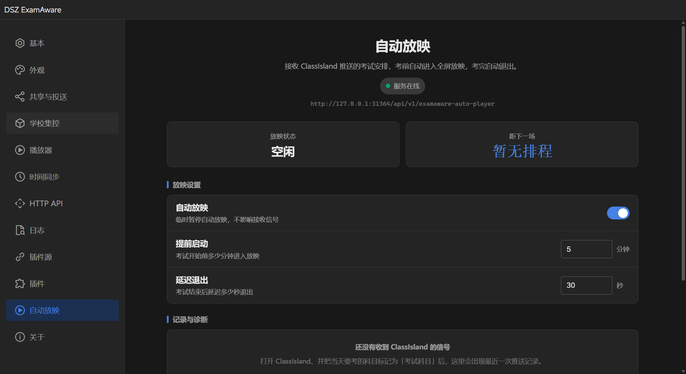
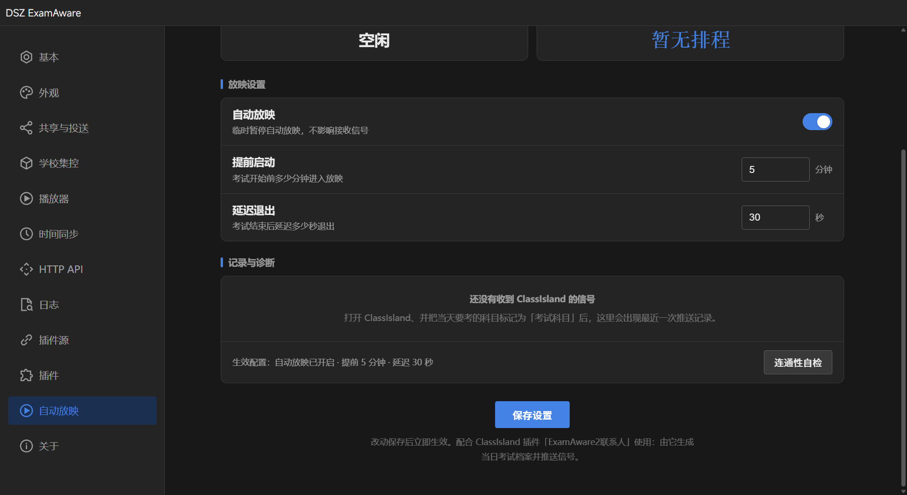

# 设置页版式（v2）

## 哪些居中、哪些靠左、哪些靠右

| 区域 | 对齐 | 为什么 |
| --- | --- | --- |
| 顶部 hero（标题 / 一句话说明 / 服务状态 / 服务地址） | **居中** | 内容短，左右留白对称时读起来像"这一页的身份"，而不是列表里的一条；也顺便把整页的视觉重心拉到中间 |
| KPI（放映状态、距下一场） | **居中** | 短数值居中最好读；两块等宽卡片形成对称结构，页面不再"一边倒" |
| 空状态（还没收到信号） | **居中** | 无数据时给一句话，居中表示"这里暂时没有内容"，而不是一条被隐藏的列表项 |
| 底部主按钮「保存设置」+ 说明 | **居中** | 单一主操作，居中收束视线；说明文字在按钮下方居中，不与表单标签混在一列 |
| 分区标题（放映设置 / 记录与诊断） | **靠左** | 带竖色条，作为扫读起点；长页面里左对齐的标题更容易定位 |
| 表单行（标签 + 说明） | **靠左** | 同一列起点对齐，眼睛沿一条竖线往下扫；居中会让每行起点不同，反而更累 |
| 控件（开关 / 数字输入 / 次要按钮） | **靠右** | 标签在左、控件在右是表单行的标准读法，视线终点正好落在可操作的地方 |

## 结构

1. **hero** —— 标题、一句说明、服务状态 pill、服务地址
2. **KPI 两列** —— 放映状态 / 距下一场（等宽数字）
3. **当前场次** —— 有场次时才出现；信息左对齐，右侧「立即停止放映」
4. **放映设置** —— 三行表单：标签左、控件右
5. **记录与诊断** —— 空状态居中；有信号/错误后改为逐行左对齐
6. **底部** —— 居中主按钮「保存设置」+ 居中说明

## 修订记录

- **v1**：整页 `max-width:760px` 但贴着左侧（`.settings-content` 本身很宽），所有内容一条左对齐竖列，右侧留一大片空白，整体观感"全部偏左"。
- **v2**：容器 `margin:0 auto` 在内容区居中；顶部与底部居中收束，中段保持左对齐以便扫读。
